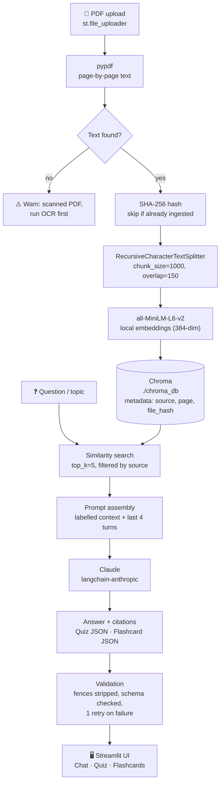

# 📚 StudyMate AI

An AI study assistant that turns your own PDF lecture notes into a tutor you can
interrogate, a quiz that grades you, and a flashcard deck you can export to Anki.

Everything is grounded in **your** documents: retrieval happens locally over a
persistent Chroma vector database, embeddings run on your machine for free, and
the model is instructed to answer only from the retrieved pages — if the answer
is not in your notes, StudyMate says so instead of inventing one.

---

## Features

| Area | What it does |
| --- | --- |
| **Ingestion** | Upload one or more PDFs, extract text page by page, split into overlapping chunks, embed locally, store in a persistent Chroma collection. |
| **De-duplication** | Each file is hashed with SHA-256; re-uploading the same PDF is skipped instead of doubling your index. |
| **Scanned-PDF handling** | Pages with no selectable text are detected and reported with a clear "run OCR first" warning rather than silently indexing nothing. |
| **Document scoping** | The sidebar lists every ingested document and lets you restrict retrieval to a subset via metadata filtering. |
| **Chat / Q&A** | `st.chat_message` interface with session history, top-5 retrieval, inline page citations, an expandable "View retrieved context" panel, and the last 4 turns replayed so follow-ups work. |
| **Quiz** | 3–15 multiple-choice questions at easy/medium/hard, generated as strict JSON, validated, rendered as radio buttons, auto-graded with per-question explanations and a CSV download. |
| **Flashcards** | 5–30 cards as strict JSON, a flip-card reviewer with prev/next and a card counter, "Know it" / "Review again" tracking, plus an Anki-ready `front,back` CSV export. |
| **Resilience** | Every API call is wrapped with typed error handling — missing key, bad key, unknown model, rate limit, network failure — and every JSON generation retries once with a correction prompt before giving up. |

---

## Architecture



### Module map

| File | Responsibility |
| --- | --- |
| `app.py` | Streamlit UI only: layout, widgets, session state. No model or database logic. |
| `config.py` | Every setting and secret, read from `.env` through `python-dotenv`. |
| `ingest.py` | PDF extraction, chunking, hashing, Chroma writes, cached resources. |
| `rag.py` | Retrieval, the grounded Q&A chain, and the shared JSON generation + retry loop. Owns every Claude call. |
| `quiz.py` | Quiz generation, grading, CSV export. |
| `flashcards.py` | Flashcard generation, review status, Anki export. |
| `prompts.py` | All prompt text, in one reviewable place. |
| `utils.py` | Logging, hashing, JSON extraction/validation, CSV writing, error translation. |

---

## Setup

Requires **Python 3.11+**.

```bash
# 1. Clone and enter the project
git clone <your-repo-url>
cd studymate-ai

# 2. Create and activate a virtual environment
python -m venv .venv
source .venv/bin/activate          # macOS / Linux
.venv\Scripts\Activate.ps1         # Windows PowerShell

# 3. Install dependencies
pip install --upgrade pip
pip install -r requirements.txt

# 4. Configure your API key
cp .env.example .env               # copy .env.example .env  on Windows
#    then edit .env and paste your key from
#    https://console.anthropic.com/settings/keys

# 5. Run
streamlit run app.py
```

The app opens at <http://localhost:8501>.

The first run downloads the `all-MiniLM-L6-v2` embedding model (~90 MB) from
Hugging Face and caches it locally; later runs are offline for embeddings.

Run the tests with:

```bash
pytest -q
```

---

## How the RAG pipeline works

**1. Ingest.** `pypdf` extracts text one page at a time, so every chunk keeps a
`page` number. Each chunk carries `{source, page, file_hash}` metadata — that
metadata is what makes citations and per-document filtering possible later.

**2. Chunk.** `RecursiveCharacterTextSplitter` splits on paragraph → line →
sentence → word boundaries, in that order, so chunks break where humans would
break them.

**3. Embed.** `sentence-transformers/all-MiniLM-L6-v2` runs locally on the CPU.
It is small (384 dimensions), fast, free, and strong enough for lecture notes.
Vectors are normalised so cosine similarity behaves predictably.

**4. Store.** Chroma persists to `./chroma_db`, so your library survives restarts.
Chunk ids are `"{file_hash}:{n}"`, which makes re-ingesting the same file
idempotent even if the hash check is bypassed.

**5. Retrieve.** A question runs a similarity search for the top 5 chunks,
filtered by the `source` values you selected in the sidebar. For quizzes and
flashcards with **no** topic, retrieval is replaced by *even sampling* — chunks
are sorted by document and page, then taken at a regular stride, so a generated
deck covers the whole file instead of clustering around whatever the first chunk
happened to mention.

**6. Generate.** Retrieved chunks are formatted with a `[lecture3.pdf, p. 4]`
header above each one and placed in the system prompt. The model is told the
context is the only source of truth, and to reply exactly *"I couldn't find that
in your notes."* when it is not enough. Because the page label sits next to the
text it belongs to, citations stay accurate.

**7. Validate.** Quiz and flashcard replies must be strict JSON. `utils.py`
strips code fences, falls back to extracting the outermost `{...}` block, then
validates the schema: four options per question, `correct_index` in range 0–3,
non-empty fronts and backs, duplicate cards dropped. On failure the model gets
**one** correction prompt containing the parser error and its own previous
output; a second failure surfaces a clear message instead of a stack trace.

### Key design decisions

| Decision | Value | Why |
| --- | --- | --- |
| `chunk_size` | 1000 characters | Roughly a paragraph or two — big enough to hold a complete idea, small enough that five of them fit comfortably in a prompt and stay on topic. |
| `chunk_overlap` | 150 characters | ~15%. Enough that a definition split across a boundary survives in at least one chunk; small enough to avoid bloating the index. |
| `top_k` | 5 | Enough evidence for a well-supported answer without diluting the prompt with weak matches, which is what makes models drift off-source. |
| Page-level extraction | one document per page | Citations are only as precise as the metadata. Extracting the whole PDF as one string would make page numbers unrecoverable. |
| Grounding prompt | explicit refusal string | A tutor that guesses is worse than one that admits a gap. The prompt names the exact sentence to use, which makes the behaviour testable. |
| No `temperature` | omitted | Current Claude models reject sampling parameters; deterministic-by-default output is also what you want for graded quizzes. |
| JSON, not tool-calling | strict JSON + validator | Keeps the project readable and provider-agnostic, and the validator catches the failure mode that matters (a malformed deck) regardless of how the JSON was produced. |
| Embeddings local, generation remote | MiniLM + Claude | Embedding thousands of chunks via an API is slow and costly; generation is where a frontier model earns its keep. |
| `@st.cache_resource` | embeddings, vector store, LLM client | Streamlit re-runs the whole script on every interaction. Without caching, each click would reload a 90 MB model. |

---

## Project structure

```
studymate-ai/
├── app.py                 # Streamlit UI (entry point)
├── config.py              # Settings: model name, chunk size, top_k, paths
├── ingest.py              # PDF loading, chunking, embedding, storing in Chroma
├── rag.py                 # Retrieval + question answering with citations
├── quiz.py                # Quiz generation (structured JSON output)
├── flashcards.py          # Flashcard generation (structured JSON output)
├── prompts.py             # All prompt templates in one place
├── utils.py               # JSON parsing/validation helpers, logging
├── requirements.txt
├── .env.example
├── tests/test_basic.py    # Tests for chunking and JSON parsing
└── README.md
```

---

## Troubleshooting

| Symptom | Fix |
| --- | --- |
| *"No `ANTHROPIC_API_KEY` found"* | Create `.env` from `.env.example` and restart the app — `.env` is read at import time. |
| *"No selectable text found"* | The PDF is a scan. Run OCR (`ocrmypdf in.pdf out.pdf`) and upload the result. |
| *Model not found* | Set a valid `ANTHROPIC_MODEL` in `.env` (e.g. `claude-sonnet-5`). |
| Sidebar shows stale documents | Use **Clear all data**, or delete the `./chroma_db` folder and restart. |
| First run is slow | The embedding model is downloading. It is cached afterwards. |

---

## Future improvements

- **OCR for scanned PDFs** — auto-detect image-only pages and run Tesseract /
  OCRmyPDF in the ingestion pipeline instead of warning the user.
- **Spaced repetition scheduling** — persist per-card review history and
  implement SM-2 so "Review again" cards resurface on an optimal schedule.
- **User accounts** — per-user Chroma collections plus auth, so a deployed
  instance can serve a study group without mixing libraries.
- **Answer-quality evaluation** — a held-out set of question/answer pairs scored
  for groundedness and citation accuracy, run in CI to catch prompt regressions.
- **Deployment to Streamlit Cloud** — move the API key to `st.secrets`, swap the
  local Chroma directory for a hosted vector store (persistent disks are
  ephemeral on Streamlit Cloud), and pin the embedding model in the build cache.
- **Hybrid retrieval** — combine BM25 keyword search with dense vectors and
  re-rank, which noticeably helps with formulae and acronym-heavy notes.
